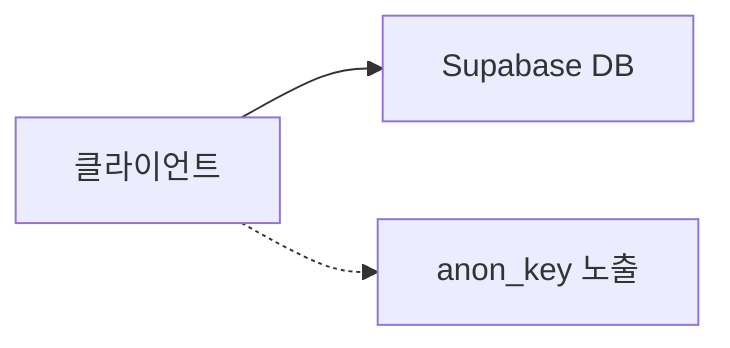
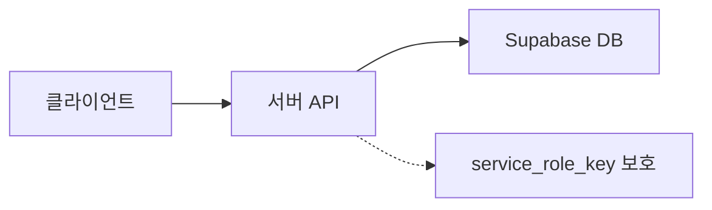

결혼 준비를 하다 보면 할 일이 **진짜** 많다.
식장, 스드메, 신혼여행… 그리고 모바일 청첩장까지.

처음엔 종이 청첩장을 고르면 모바일 청첩장도 무료로 준다길래
“무료로 만들면 되겠지” 싶었다.

근데 막상 업체에서 제공하는 무료 청첩장들을 보니

- 디자인이 내 취향이 아니고
- 구성/배치 커스텀도 제한적이고
- 예쁘게 만들려면 결국 추가 비용이 들었다

게다가 청첩장 모임(청모)까지 시간이 조금 남아 있어서,
그냥 **직접 만들어보기로 했다. (with. 바이브 코딩)**!


### [청첩장 구경하기 >](https://wedding.ttukttak.xyz/invitation)

---

## 바이브 코딩이 뭐냐면요

바이브 코딩(Vibe Coding)은 **AI(LLM)** 한테 자연어로 원하는 “느낌/결과"를 던지고,
AI가 코드를 뽑아주면 내가 그걸 붙이고 고치면서 완성해가는 방식이다.

정교한 설계부터 들어가는 게 아니라,

* “이 섹션은 이런 느낌"
* “여기는 감성 있는 카드 UI"
* “버튼 누르면 계좌 복사"
* “카톡 공유했을 때 썸네일 잘 나오게"

이런 식으로 **요구사항 → 프롬프트 → 코드 → 수정** 루프를 엄청 빨리 돌리는
딱, 프로토 타입이나 인트로 페이지를 빠르게 만들 때 아주 좋은 접근법 같다.

이번 프로젝트에서의 역할 분담은 대충 이랬다.

- 나: PM + 최종 결정(요구사항/디자인/우선순위)
- 기획자 : GPT-4o (ChatGPT Plus)
- 개발자 1 : Claude-sonnet-4 (Amazon Q)
- 개발자 2 : GitHub Copilot

첫 바이브 코딩 팀 결성 완료.

---

## 개발 진행

전체 작업은 아래 순서로 굴렸다.

1. **[나]** 디자인 톤/섹션 구성/기능 목록 뽑기
2. **[ChatGPT]** 기능/비기능 요구사항을 PRD 형태로 정리
3. **[나 & Amazon Q]** PRD 기반으로 폴더 구조/데이터 구조 설계
4. **[ALL]** 프롬프트 전달 → 코드 생성
5. **[나]** 화면 보면서 수정 포인트 정리 → 재프롬프트
6. 4~5 반복
7. **[나]** 최종 점검 → Vercel 배포


## 요구사항 정리 & 기획서 만들기

업체 청첩장들을 훑으면서 “내가 진짜 원하는 기능”만 뽑았다.

- 방명록(댓글)
- 갤러리(사진 여러 장 + 모달 확대)
- 지도 + 길찾기 링크
- 연락하기(신랑/신부/혼주)
- 계좌 안내 + **원터치 복사**
- 하객 사진 업로드
- 카카오톡 공유 OG(썸네일/제목/설명)

그리고 이런 식으로 **추상적인 요구사항**을 한 번 던졌다.

```
모바일 청첩장 직접 만들 거야.
기능적 요구사항, 비기능적 요구사항, 프로젝트 설계까지 다 포함해서 기획서 작성해줘.

원하는 디자인은 깔끔+따뜻한 감성의 브런치(https://brunch.co.kr/) 스타일로.

청첩장은 한 페이지로 구성하고 섹션은 8개 정도면 좋겠어.
필수 기능:
- Hero(첫 화면)
- 초대 문구
- 날짜/장소
- 갤러리(썸네일+모달 확대)
- 지도 + 길찾기 링크
- 계좌 안내 + 원터치 복사 + 토스트
- 연락하기(전화/문자)
- 카카오톡 공유 OG(썸네일/제목/설명)

Next.js(App Router) + TS + Tailwind + Vercel로 개발할 거고
사진은 s3 연동해서 저장할 예정이고, 사용자 정보, 댓글, 업로드 기록은 supabase로 관리할 거야.

섹션 단위로 개발할 수 있게 기획서랑 프롬프트까지 뽑아줘.
청첩장에 들어가는 정보들은 별도의 설정파일로 분리해서 관리할 수 있도록 해줘.
```

그러면 AI가 “기획서를 뽑기 위한 프롬프트”를 다시 만들어준다.

```
너는 모바일 청첩장 제작을 위한 PO(기획) + 시니어 프론트엔드 아키텍트야.
아래 내용을 바탕으로 통합 기획서(PRD: Functional + Non-functional + Architecture)를 작성해줘.

중요:
- 기능 요구사항(What)과 비기능/설계(How)가 섞이지 않도록 반드시 분리
- 출력은 마크다운
- 나는 백엔드 개발자라서 애매한 말 말고 행동/조건/체크리스트 중심으로
...
```

이 프롬프트를 다시 ChatGPT에 던져서 기획서를 확정했고,
그 뒤부터는 “context 기반”으로 섹션을 하나씩 뽑아내는 게 엄청 쉬워졌다.


### 프로젝트 구조잡기

Next.js App Router 기반으로 청첩장과 사진 업로드 기능을 분리한 구조로 설계했다.

```
src/
├── context.md        # 기획서 전체
├── app/
│   ├── invitation/   # 청첩장 메인 페이지
│   ├── (photos)/     # 사진 관련 페이지들
│   └── api/          # API 라우트들
├── components/
│   └── invitation/   # 청첩장 섹션 컴포넌트들
└── lib/
    ├── supabase.ts   # Supabase 연동
    └── invitation/   # 유틸리티 (supabase 등)
```

환경 변수는 두 개로 분리:
- `.env.local`: AWS/Supabase 설정
- `.env.invitation`: 청첩장 정보 (날짜/장소/문구/계좌/연락처)

프로젝트에 기획서를 포함하여 Amazon Q가 전체 맥락을 이해할 수 있게 했다.
>목표 → 정보구조 → 기능 스펙 → 화면설계 → 운영 계획 순으로 구성

예를 들면, 아래의 주제들 이외에 개요, 디자인, 운영 계획 등도 포함됐다.
```
# 기능적 요구사항 - 섹션/기능 중심
*"페이지가 어떤 섹션으로 구성되는지"와 "각 섹션이 어떤 기능을 하는지".*
- 페이지 구성: 단일 페이지
- 섹션 목록(우선순위 포함)
    - Hero / 초대 문구 / 일정·장소 / 갤러리 / 지도·길찾기 / 계좌 복사 / 연락하기 / 마무리
- 섹션별 상세 요구사항
    - 버튼/모달/토스트/탭 같은 UX 동작
    - 필요한 데이터(문구/날짜/계좌/연락처/이미지 리스트)
    - 엣지 케이스(계좌가 1개만 있을 때, 혼주 연락처가 없을 때 등)
  ...

# 비기능 요구사항 - 기준/원칙 중심
- 공유/SEO: OG 최우선 (`og.png` 고정 + metadata 설정)
- 성능: 갤러리 로딩 전략(썸네일 우선, 원본은 모달에서)
- 호환성: iOS Safari / Android Chrome 실기기 우선
- 접근성: 터치 영역/대비/폰트 크기 최소 기준
- 데이터 구조: `.env.local`활용하여 날짜/문구/계좌/연락처 완전 분리
- 프로젝트 구조: `sections/` 중심으로 조립 가능한 구조 (app/components/content/public)
  ...
```

여기서부터 바이브 코딩이 편해졌다.
"context 기반으로 Gallery 섹션 만들어줘" 하면
`src/components/invitation/Gallery.tsx` 컴포넌트를 만들고 코드를 쫙쫙 뽑아줬다.

프론트 지식이 부족해도 내가 원하는 화면과 기능 도출과정은 그렇게 어렵지 않았다.
복잡한 기능이 들어가 있지 않아서 더 그랬던 것 같다.

### UI 뽑아내기

> "축하 메시지 섹션 만들어줘.
> 메시지 남기기, 더보기 버튼이 있고 사이에 댓글 리스트 노출.
> 댓글 리스트는 카드 타입이고 `/context.md` 디자인 규칙 참고.
>
> supabase 연동 후 저장, 수정, 삭제 가능해야 해.
> 저장은 작성자 이름(필수), 메시지 내용(필수), 비밀번호 포함.
> 삭제는 soft delete 할 수 있게.
> 조회는 댓글 5개씩 페이징 조회 더보기 버튼 누르면 다음 페이지 로드"


> "SNS 공유할 때 OG 태그 부분들 잘 안먹힌거 같은데? 썸네일은 `/public/og.png` 고정이고, 제목과 설명은 .env 설정에서 불러오도록.


이런 프롬프트를 처음에 던지고 나온 코드들을 눈으로 보고
수정 포인트나 원하는 포인트를 추가로 요청하는 방식으로 진행했다.


### DB 연동

Supabase로 방명록, 업로드 된 사진 데이터를 관리하기로 했다.

> “유저는 방명록을 작성하고 사진을 업로드할 수 있어.
> 방명록: 작성자 이름, 메시지, 비밀번호, 작성일시, 삭제 플래그
> 사진 업로드: 업로더 이름, 연락처, 사진 URL, 업로드 일시, 삭제 플래그
> 테이블 스키마 설계해줘.”

### 방명록 테이블

* `password`는 **평문 저장 금지** → 해시 저장(서버 API에서 처리)
* `visible`로 soft delete

```sql
CREATE TABLE comments (
  id UUID DEFAULT gen_random_uuid() PRIMARY KEY,
  name VARCHAR(100) NOT NULL,
  message TEXT NOT NULL,
  password_hash VARCHAR(255) NOT NULL,
  visible BOOLEAN DEFAULT TRUE,
  created_at TIMESTAMP DEFAULT NOW(),
  updated_at TIMESTAMP DEFAULT NOW()
);
```

### 사진 업로드 메타 테이블

* 나중에 운영/정리 편하게 `storage_key`도 함께 저장

```sql
CREATE TABLE photos (
  id UUID DEFAULT gen_random_uuid() PRIMARY KEY,
  name VARCHAR(50) NULL,
  phone VARCHAR(20) NULL,
  photo_url TEXT NOT NULL,
  storage_key TEXT NULL,
  visible BOOLEAN DEFAULT TRUE,
  created_at TIMESTAMP DEFAULT NOW()
);
```

테이블을 만든 다음에는 DDL → API → 프론트 연동까지 한 번에 뽑아냈다.

### 트러블 슈팅

### 1) 사진 업로드 방식 변경 (Vercel 413)

처음엔 “서버로 업로드 → 서버가 S3에 저장” 구조로 만들었는데,
테스트 중 **413(Payload Too Large)** 가 터졌다.

원인은 단순했다.
Vercel(Hobby) 환경에서 요청 바디 크기 제한에 걸린 것.

그래서 **Presigned URL 기반 S3 직접 업로드**로 전환했다.

> “프론트에서 S3로 직접 업로드하고,
> 업로드된 사진 메타데이터만 Supabase에 저장할 거야.
> S3 업로드용 Presigned URL 발급 API도 만들어줘.”


이미지 파일 경로는
`photos/${phone}/${nickname}_${timestamp}_${fileName}`
형태로 저장해서 중복을 피하고, 파일 다운 하고 난 후 정리하기 쉽게 했다.


### 2) 이미지 최적화 (webp + 리사이징)

갤러리에 올릴 웨딩 촬영 원본이 파일당 5~10MB 수준이라
로딩 속도를 위해 최적화가 필수였다.

* webp 변환
* 해상도/품질 낮춘 버전(썸네일/모달용) 분리

> “갤러리 사진 용량이 너무 커.
> webp로 변환하고, 썸네일/모달 각각 최적화 버전으로 만들어줘.”

(이 과정은 AI에게 ‘변환 방법/툴’도 같이 추천받아서 빠르게 처리했다.)

### 3) DB 접근 방식 변경 (클라이언트 직결 → 서버 API 경유)

AI가 처음에 만든 코드는 클라이언트에서 Supabase를 직접 찌르는 형태였다.

```tsx
const supabase = createClient(anon_key) // 클라이언트에서 직접 접근
const { data } = await supabase.from('comments').select('*')
const { error } = await supabase.from('comments').insert(newComment)
```

민감한 개인정보는 아니더라도,
클라이언트에서 DB에 직접 접근하는 건 운영 관점에서 찝찝했다.

그래서 **클라이언트 → 서버 API → Supabase**로 바꿨다.

**변경 전**



**변경 후**



이 구조로 바꾸니,

* 키 관리가 깔끔해지고
* 유효성 검사/레이트리밋 같은 “운영 로직”을 넣기도 쉬워졌다

## 피드백

첫 사용자는 역시 와이프, 좋아하는 모습을 보니 만들길 참 잘했다는 생각이 들었다.
덤으로 맛있는 저녁까지 얻어먹고 나니까 사이드프로젝트로 첫 수익을 얻은 기분이었다.

둘이서 방명록도 써보고 사진도 올려보면서 "이거 진짜 내가 만든 거 맞나?" 싶을 정도로 신기했다.

친구들과 가족들에게 링크를 보냈는데... 처음엔 다들 청첩장에 대한 반응이 없었다.
안 봤나? 싶어서 "내가 직접 만든 청첩장이야" 라고 말하니까
"어? 정말? 돈 주고 제작한 줄 알았어!" "이거 진짜 네가 만든 거야?"
이런 반응들이 쏟아졌다.  파는건줄 알았다니 엄청난 칭찬 아닌가!

청모도 잘 끝내고... 결혼식도 무사히 잘 치렀다! 🎉


청첩장에 사진 업로드 기능을 넣은 것도 잘 한 것 같다.
카톡으로 받은 사진들보다 정리하기 편하고,
"누가 이런 사진을 올렸지?" 하면서 갤러리를 확인하는 재미도 쏠쏠했다.


## 맺으면서

2일 만에 완성된 청첩장을 보면서 "AI 시대가 정말 왔구나" 싶었다.
혼자서 처음부터 끝까지 만들었다면 최소 2-3주는 걸렸을 텐데 말이다.

제일 신기했던 건 내가 "갤러리에 모달 추가해줘", "댓글 기능 만들어줘" 이런 식으로 대충 말해도 AI가 척척 알아듣고 바로 쓸 수 있는 코드를 뽑아준다는 거였다.

물론 완벽하지는 않았다. 보안이나 성능 최적화는 내가 직접 챙겨야 했고, 전체적인 구조를 잡는 것도 결국 사람이 해야 할 일이었다.

생각해보니 당연한 얘기다. 내가 "대충 이런 느낌으로 만들어줘" 하면서 완벽한 아키텍처까지 기대하는 게 무리였던 거지.

그래도 결혼 준비로 정신없는 와중에 원하는 기능을 다 구현할 수 있었고, 실제로 지인들이 방명록 남기고 사진 올리는 걸 보니 뿌듯했다.

앞으로도 이런 빠른 프로토타입이나 일회성 프로젝트에는 AI를 적극 활용할 생각이다.

*"기술은 도구일 뿐, 중요한 건 무엇을 만들고 싶은지 아는 것"*

이번 프로젝트를 통해 다시 한번 느꼈다.
AI가 아무리 똑똑해져도, 결국 뭘 만들지 정하고 사용자가 어떤 경험을 하길 원하는지 설계하는 건 사람의 몫이다.

바이브 코딩은 그 과정을 더 빠르고 재미있게 만들어주는 멋진 방법인 것 같다.

끝!
